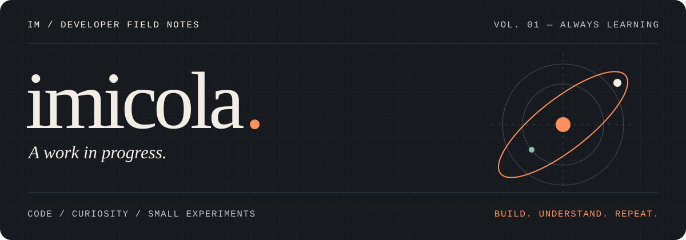

<p align="center">
  
</p>

<p align="center">
  <a href="https://github.com/imicola?tab=repositories">项目 / Projects</a> &nbsp;·&nbsp;
  <a href="https://github.com/imicola/Questions-and-Impressions">笔记 / Notes</a> &nbsp;·&nbsp;
  <a href="mailto:imicola@outlook.com">联系 / Say hello</a>
</p>

# 你好，我是 Imicola。

软件工程学生，写代码，也记录从「能运行」到「弄明白」的过程。

从 C++ 和算法题出发，慢慢走向 Go、后端开发与自己的小工具。这里放着我的练习、实验，以及一些想认真做好的东西。

> 把好奇心写成代码，把问题留给下一次迭代。

## 01 / 正在探索

- **Go 与后端开发** — 在实际项目里理解接口、数据与服务之间的关系。
- **C++ 与算法** — 保持解题，也把思路整理成可以回看的笔记。
- **工具与知识管理** — 尝试让记录、检索和日常使用变得更顺手。

## 02 / 项目切片

### [Notebit ↗](https://github.com/imicola/notebit)

本地优先的 Markdown 笔记应用，把写作、知识连接与 AI 检索放在一起。一次关于个人知识管理的工具实验。

`Go` `Wails` `React` `SQLite` · AI 辅助开发项目

### [Smart Study Room ↗](https://github.com/imicola/smart-study-room)

面向高校共享自习室的预约与管理平台。团队课程项目，参与用户与权限模块、总体架构和协作整合。

`Go` `Vue` `PostgreSQL` `Redis` · 团队课程设计

### [Questions & Impressions ↗](https://github.com/imicola/Questions-and-Impressions)

从一道题到一种思路。收录 C++、算法竞赛的习题与学习笔记，也是这个主页最初的起点。

`C++` `Algorithms` `Learning notes` · 原 LuoGutest

[查看其他仓库 →](https://github.com/imicola?tab=repositories)

## 03 / 常用工具

**写代码** &nbsp; Go · C++ · Python<br />
**做项目** &nbsp; Git · VS Code · Windows / WSL

### 也在这些地方解题

[Codeforces](https://codeforces.com/profile/imicola) &nbsp; / &nbsp;
[洛谷](https://www.luogu.com.cn/user/1422275) &nbsp; / &nbsp;
[牛客](https://ac.nowcoder.com/acm/contest/profile/693475085)

## 04 / 开发足迹

一些自动记录的日常切片，展开可以查看最近的编码统计。

<details>
<summary><b>打开开发日志 / WakaTime</b></summary>


<!--START_SECTION:waka-->


**🐱 My GitHub Data** 

> 📦 558.3 kB Used in GitHub's Storage 
 > 
> 🏆 263 Contributions in the Year 2026
 > 
> 🚫 Not Opted to Hire
 > 
> 📜 18 Public Repositories 
 > 
> 🔑 1 Private Repositories 
 > 
**I'm an Early 🐤** 

```text
🌞 Morning                240 commits         ██████░░░░░░░░░░░░░░░░░░░   22.30 % 
🌆 Daytime                421 commits         ██████████░░░░░░░░░░░░░░░   39.13 % 
🌃 Evening                368 commits         █████████░░░░░░░░░░░░░░░░   34.20 % 
🌙 Night                  47 commits          █░░░░░░░░░░░░░░░░░░░░░░░░   04.37 % 
```
📅 **I'm Most Productive on Wednesday** 

```text
Monday                   133 commits         ███░░░░░░░░░░░░░░░░░░░░░░   12.36 % 
Tuesday                  164 commits         ████░░░░░░░░░░░░░░░░░░░░░   15.24 % 
Wednesday                410 commits         ██████████░░░░░░░░░░░░░░░   38.10 % 
Thursday                 88 commits          ██░░░░░░░░░░░░░░░░░░░░░░░   08.18 % 
Friday                   115 commits         ███░░░░░░░░░░░░░░░░░░░░░░   10.69 % 
Saturday                 71 commits          ██░░░░░░░░░░░░░░░░░░░░░░░   06.60 % 
Sunday                   95 commits          ██░░░░░░░░░░░░░░░░░░░░░░░   08.83 % 
```


📊 **This Week I Spent My Time On** 

```text
🕑︎ Time Zone: Asia/Shanghai

💬 Programming Languages: 
Markdown                 10 hrs 28 mins      ███████░░░░░░░░░░░░░░░░░░   28.41 % 
Rust                     6 hrs 46 mins       █████░░░░░░░░░░░░░░░░░░░░   18.34 % 
Go                       5 hrs 16 mins       ████░░░░░░░░░░░░░░░░░░░░░   14.28 % 
Other                    5 hrs 6 mins        ███░░░░░░░░░░░░░░░░░░░░░░   13.85 % 
Image (png)              1 hr 59 mins        █░░░░░░░░░░░░░░░░░░░░░░░░   05.42 % 

🔥 Editors: 
ZCode                    22 hrs 10 mins      ███████████████░░░░░░░░░░   60.10 % 
Zed                      12 hrs 3 mins       ████████░░░░░░░░░░░░░░░░░   32.67 % 
Codex Vscode             2 hrs 24 mins       ██░░░░░░░░░░░░░░░░░░░░░░░   06.54 % 
VS Code                  11 mins             ░░░░░░░░░░░░░░░░░░░░░░░░░   00.52 % 
Antigravity CLI          3 mins              ░░░░░░░░░░░░░░░░░░░░░░░░░   00.17 % 

🐱‍💻 Projects: 
imicolaSSH               9 hrs 44 mins       ███████░░░░░░░░░░░░░░░░░░   26.41 % 
sentinel-go              3 hrs 29 mins       ██░░░░░░░░░░░░░░░░░░░░░░░   09.46 % 
Unknown Project          2 hrs 31 mins       ██░░░░░░░░░░░░░░░░░░░░░░░   06.85 % 
AI_Local_Studio          2 hrs 25 mins       ██░░░░░░░░░░░░░░░░░░░░░░░   06.56 % 
frpdeck                  2 hrs 5 mins        █░░░░░░░░░░░░░░░░░░░░░░░░   05.69 % 

💻 Operating System: 
Windows                  36 hrs 53 mins      █████████████████████████   100.00 % 
```

🤖 **AI Coding This Week** 

```text
⏱ AI Coding Time: 33 hrs 19 mins (90.32%)

✍️ 59,300 lines written by AI, 191 lines written by hand (99.68% AI-written)

🔤 20,773,023 Input Tokens, 4,130,039 Output Tokens

💵 $1974.26 Estimated AI Cost This Week

🧠 141 AI Sessions, 511 AI Prompts

ZCode                    56,620 lines        ████████████████████████░   95.48 % 
Gemini                   2,309 lines         █░░░░░░░░░░░░░░░░░░░░░░░░   03.89 % 
Codex-Vscode             191 lines           ░░░░░░░░░░░░░░░░░░░░░░░░░   00.32 % 
GPT                      180 lines           ░░░░░░░░░░░░░░░░░░░░░░░░░   00.30 % 
GLM                      0 lines             ░░░░░░░░░░░░░░░░░░░░░░░░░   00.00 % 

🔎 AI Coding Insights:
🤖 AI-Driven — 99.68% of written lines came from AI
📚 Verbose Prompter — average 5,040 characters per prompt
🔁 Iterative Prompter — average 4 prompts per session
🚀 High AI Trust — 0.38% of changed lines were hand-edited
```

**I Mostly Code in TypeScript** 

```text
TypeScript               4 repos             █████░░░░░░░░░░░░░░░░░░░░   19.05 % 
Go                       3 repos             ████░░░░░░░░░░░░░░░░░░░░░   14.29 % 
HTML                     3 repos             ████░░░░░░░░░░░░░░░░░░░░░   14.29 % 
Vue                      2 repos             ██░░░░░░░░░░░░░░░░░░░░░░░   09.52 % 
Rust                     1 repo              █░░░░░░░░░░░░░░░░░░░░░░░░   04.76 % 
```


**Timeline**


 Last Updated on 22/10/2026 21:48:46 UTC
<!--END_SECTION:waka-->

</details>

---

<p align="center">
  <b>还在学习，也一直在动手。</b><br />
  <sub>Still learning. Still building.</sub>
</p>

<p align="center">
  <a href="mailto:imicola@outlook.com">imicola@outlook.com</a>
  &nbsp; / &nbsp;
  <a href="https://github.com/imicola">@imicola</a>
</p>
