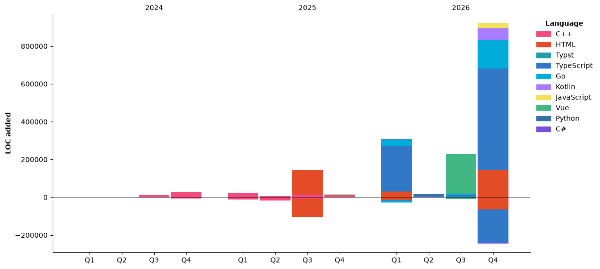

<p align="center">
  
</p>

<p align="center">
  <a href="https://github.com/imicola?tab=repositories">项目 / Projects</a> &nbsp;·&nbsp;
  <a href="https://github.com/imicola/Questions-and-Impressions">笔记 / Notes</a> &nbsp;·&nbsp;
  <a href="mailto:imicola@outlook.com">联系 / Say hello</a>
</p>

# 你好，我是 Imicola。

软件工程学生，写代码，也记录从「能运行」到「弄明白」的过程。

从 C++ 和算法题出发，慢慢走向 Go、后端开发与自己的小工具。这里放着我的练习、实验，以及一些想认真做好的东西。

> 把好奇心写成代码，把问题留给下一次迭代。

## 01 / 正在探索

- **Go 与后端开发** — 在实际项目里理解接口、数据与服务之间的关系。
- **C++ 与算法** — 保持解题，也把思路整理成可以回看的笔记。
- **工具与知识管理** — 尝试让记录、检索和日常使用变得更顺手。

## 02 / 项目切片

### [Notebit ↗](https://github.com/imicola/notebit)

本地优先的 Markdown 笔记应用，把写作、知识连接与 AI 检索放在一起。一次关于个人知识管理的工具实验。

`Go` `Wails` `React` `SQLite` · AI 辅助开发项目

### [Smart Study Room ↗](https://github.com/imicola/smart-study-room)

面向高校共享自习室的预约与管理平台。团队课程项目，参与用户与权限模块、总体架构和协作整合。

`Go` `Vue` `PostgreSQL` `Redis` · 团队课程设计

### [Questions & Impressions ↗](https://github.com/imicola/Questions-and-Impressions)

从一道题到一种思路。收录 C++、算法竞赛的习题与学习笔记，也是这个主页最初的起点。

`C++` `Algorithms` `Learning notes` · 原 LuoGutest

[查看其他仓库 →](https://github.com/imicola?tab=repositories)

## 03 / 常用工具

**写代码** &nbsp; Go · C++ · Python<br />
**做项目** &nbsp; Git · VS Code · Windows / WSL

### 也在这些地方解题

[Codeforces](https://codeforces.com/profile/imicola) &nbsp; / &nbsp;
[洛谷](https://www.luogu.com.cn/user/1422275) &nbsp; / &nbsp;
[牛客](https://ac.nowcoder.com/acm/contest/profile/693475085)

## 04 / 开发足迹

一些自动记录的日常切片，展开可以查看最近的编码统计。

<details>
<summary><b>打开开发日志 / WakaTime</b></summary>


<!--START_SECTION:waka-->


**🐱 My GitHub Data** 

> 📦 602.3 kB Used in GitHub's Storage 
 > 
> 🏆 462 Contributions in the Year 2026
 > 
> 💼 Opted to Hire
 > 
> 📜 22 Public Repositories 
 > 
> 🔑 1 Private Repositories 
 > 
**I'm an Early 🐤** 

```text
🌞 Morning                250 commits         █████░░░░░░░░░░░░░░░░░░░░   19.13 % 
🌆 Daytime                532 commits         ██████████░░░░░░░░░░░░░░░   40.70 % 
🌃 Evening                476 commits         █████████░░░░░░░░░░░░░░░░   36.42 % 
🌙 Night                  49 commits          █░░░░░░░░░░░░░░░░░░░░░░░░   03.75 % 
```
📅 **I'm Most Productive on Wednesday** 

```text
Monday                   148 commits         ███░░░░░░░░░░░░░░░░░░░░░░   11.32 % 
Tuesday                  173 commits         ███░░░░░░░░░░░░░░░░░░░░░░   13.24 % 
Wednesday                416 commits         ████████░░░░░░░░░░░░░░░░░   31.83 % 
Thursday                 124 commits         ██░░░░░░░░░░░░░░░░░░░░░░░   09.49 % 
Friday                   152 commits         ███░░░░░░░░░░░░░░░░░░░░░░   11.63 % 
Saturday                 135 commits         ███░░░░░░░░░░░░░░░░░░░░░░   10.33 % 
Sunday                   159 commits         ███░░░░░░░░░░░░░░░░░░░░░░   12.17 % 
```


📊 **This Week I Spent My Time On** 

```text
🕑︎ Time Zone: Asia/Shanghai

💬 Programming Languages: 
Go                       5 hrs 25 mins       ████████░░░░░░░░░░░░░░░░░   31.58 % 
Markdown                 4 hrs 44 mins       ███████░░░░░░░░░░░░░░░░░░   27.63 % 
JavaScript               2 hrs 28 mins       ████░░░░░░░░░░░░░░░░░░░░░   14.45 % 
JSON                     1 hr 46 mins        ███░░░░░░░░░░░░░░░░░░░░░░   10.38 % 
Other                    1 hr 5 mins         ██░░░░░░░░░░░░░░░░░░░░░░░   06.34 % 

🔥 Editors: 
Zed                      6 hrs 53 mins       ██████████░░░░░░░░░░░░░░░   40.21 % 
ZCode                    6 hrs 4 mins        █████████░░░░░░░░░░░░░░░░   35.43 % 
Codex Vscode             3 hrs 56 mins       ██████░░░░░░░░░░░░░░░░░░░   22.98 % 
Obsidian                 14 mins             ░░░░░░░░░░░░░░░░░░░░░░░░░   01.38 % 

🐱‍💻 Projects: 
Work                     8 hrs 22 mins       ████████████░░░░░░░░░░░░░   48.77 % 
draft-d5c23e92-99cb-4ad4-3 hrs 27 mins       █████░░░░░░░░░░░░░░░░░░░░   20.18 % 
internship_hunter        1 hr 49 mins        ███░░░░░░░░░░░░░░░░░░░░░░   10.67 % 
mygo md3e Component lib  1 hr 16 mins        ██░░░░░░░░░░░░░░░░░░░░░░░   07.45 % 
e-aiworkspace-agy-mygo-md49 mins             █░░░░░░░░░░░░░░░░░░░░░░░░   04.79 % 

💻 Operating System: 
Windows                  17 hrs 9 mins       █████████████████████████   100.00 % 
```

🤖 **AI Coding This Week** 

```text
⏱ AI Coding Time: 12 hrs 11 mins (71.03%)

✍️ 7,741 lines written by AI, 629 lines written by hand (92.49% AI-written)

🔤 6,526,426 Input Tokens, 1,289,985 Output Tokens

💵 $546.79 Estimated AI Cost This Week

🧠 83 AI Sessions, 144 AI Prompts

ZCode                    7,113 lines         ███████████████████████░░   91.78 % 
GPT                      557 lines           ██░░░░░░░░░░░░░░░░░░░░░░░   07.19 % 
OMP                      63 lines            ░░░░░░░░░░░░░░░░░░░░░░░░░   00.81 % 
Codex-Vscode             17 lines            ░░░░░░░░░░░░░░░░░░░░░░░░░   00.22 % 
GLM                      0 lines             ░░░░░░░░░░░░░░░░░░░░░░░░░   00.00 % 

🔎 AI Coding Insights:
🤖 AI-Driven — 92.49% of written lines came from AI
📚 Verbose Prompter — average 5,091 characters per prompt
🔁 Iterative Prompter — average 2 prompts per session
🚀 High AI Trust — 7.96% of changed lines were hand-edited
```

**I Mostly Code in Go** 

```text
Go                       6 repos             ██████░░░░░░░░░░░░░░░░░░░   23.08 % 
TypeScript               5 repos             █████░░░░░░░░░░░░░░░░░░░░   19.23 % 
Python                   2 repos             ██░░░░░░░░░░░░░░░░░░░░░░░   07.69 % 
Vue                      2 repos             ██░░░░░░░░░░░░░░░░░░░░░░░   07.69 % 
Rust                     1 repo              █░░░░░░░░░░░░░░░░░░░░░░░░   03.85 % 
```


**Timeline**




 Last Updated on 25/11/2026 02:42:16 UTC
<!--END_SECTION:waka-->

</details>

---

<p align="center">
  <b>还在学习，也一直在动手。</b><br />
  <sub>Still learning. Still building.</sub>
</p>

<p align="center">
  <a href="mailto:imicola@outlook.com">imicola@outlook.com</a>
  &nbsp; / &nbsp;
  <a href="https://github.com/imicola">@imicola</a>
</p>
